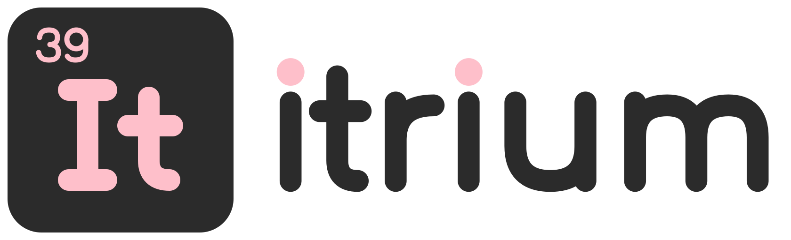

  <picture>
    <source media="(prefers-color-scheme: dark)" srcset="itrium-lockup-on-dark.svg">
    
  </picture>

  <strong>From a quick question to a finished application.</strong> 
  And free applications, tools and games that leave your data alone.

We help people and small businesses with software, from Indonesia: plain advice, applications
and websites built to order, and free applications, tools and games that respect your privacy.

## Free stuff

In your browser, nothing to install:

- **[Amber](https://amber.itrium.id)**: lists for to-dos and bucket lists, with categories, tags,
  steps and search. It works offline, and your lists stay on your device.
- **[Web tools](https://tools.itrium.id)**: a WhatsApp click-to-chat link maker and a bill
  splitter that run in your browser. Nothing you type is sent to us.

On your computer, for Mac, Windows and Linux:

- **[Honk](https://github.com/itriumid/honk)**: a lightweight soundboard. Give each sound its own
  keyboard shortcut and play it from whatever you have open. It never goes online.
- **[Hindsight](https://github.com/itriumid/hindsight)**: keeps the last few minutes of what was
  said, up to three hours, in memory, so you can save them when they turn out to matter.
  Encrypted while it waits, written to disk only when you save, and it never goes online.

Games:

- **[Felterra: Tall Order](https://github.com/itriumid/felterra-tall-order)**: a pixel art game of
  cats against giants, to play alone or with friends. A work in progress, built in the open.

For programmers:

- **[Rhodonite Theme](https://itrium.id/rhodonite)**: our palette for
  Visual Studio Code and the editors built on it, in dark and light, with every color checked
  to be easy to read.

All of it, with downloads, is at [itrium.id/free-stuff](https://itrium.id/free-stuff).

Everything we make for free stays free: no hidden upsell, no account wall and no
advertisements. It doesn't collect, track or sell anything, and it's open source, so you can
check.

## Get in touch

Write to us at [hello@itrium.id](mailto:hello@itrium.id), whether it's a quick question or a
whole project. The first conversation is free. To report a security problem in anything we
make, write to [security@itrium.id](mailto:security@itrium.id) instead, so it stays private
until it's fixed. Bugs, ideas and questions about what we make are welcome on
[our Discord server](https://discord.gg/ARpBjrD77C) too. More about us at
[itrium.id](https://itrium.id).

---

Itrium is the Indonesian word for yttrium: element 39.
